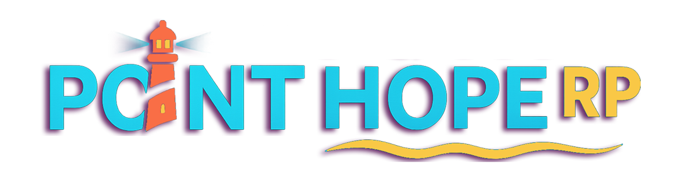

# Welcome to Point Hope RP

<figure><figcaption></figcaption></figure>


If this is your first time playing in Point Hope RP please be sure to read over the [Rules ](getting-started/quickstart/)and [Roleplay ](getting-started/roleplay-overview/)sections of the guide to make sure you understand how we do things differently here at Point Hope.&#x20;



Point Hope RP is a strict 18+ server. Any applications for anyone under 18 will be denied. You are welcome to reapply when you turn 18. Anyone found to be under 18 who lied about their age to get in will be removed from the community and may reapply when they turn 18.


Whether you're a seasoned role-player or just stepping into the world of FiveM for the first time, this comprehensive guide will help you navigate everything Point Hope RP has to offer.

From essential key binds that'll save your life in critical moments, to mastering our custom menus and systems, you'll find everything you need to become a skilled citizen of our community. This guide covers step-by-step tutorials, troubleshooting tips, server rules, character development advice, and all the unique features that make Point Hope RP special.

**What you'll discover:**

* **Essential Key binds** - Master the controls that matter most
* **Menu Navigation** - Learn our custom interfaces and systems
* **Getting Started** - Your first steps in the city
* **Roleplay Guidelines** - How to create compelling stories
* **Job Guides** - From civilian work to specialized careers
* **Troubleshooting** - Quick fixes for common issues

Ready to dive in? Let's get you equipped with everything you need to thrive in Point Hope RP. Your story starts here!

## Please Understand that this guide is a work in progess and the in city guides are not yet correctly up to date

### Jump right in&#x20;

<table data-view="cards"><thead><tr><th></th><th></th><th data-type="content-ref"></th><th data-hidden data-card-cover data-type="files"></th><th data-hidden></th><th data-hidden data-card-target data-type="content-ref"></th></tr></thead><tbody><tr><td><strong>Important Map Locations</strong></td><td>Find key areas on the map</td><td><a href="basics/important-map-locations.md">important-map-locations.md</a></td><td><a href=".gitbook/assets/FiveM_b3407_GTAProcess_ZNJuKI1Q5K.jpg">FiveM_b3407_GTAProcess_ZNJuKI1Q5K.jpg</a></td><td></td><td><a href="basics/important-map-locations.md">important-map-locations.md</a></td></tr><tr><td><strong>Keybinds</strong></td><td>Important Keybinds</td><td><a href="basics/important-keybinds-and-commands.md">important-keybinds-and-commands.md</a></td><td></td><td></td><td><a href="basics/important-keybinds-and-commands.md">important-keybinds-and-commands.md</a></td></tr><tr><td><strong>Roleplay Guide</strong></td><td>Roleplay isn't always easy for new players, Check out the roleplay guide for some important info.</td><td><a href="getting-started/roleplay-overview/">roleplay-overview</a></td><td></td><td></td><td><a href="getting-started/roleplay-overview/">roleplay-overview</a></td></tr></tbody></table>
