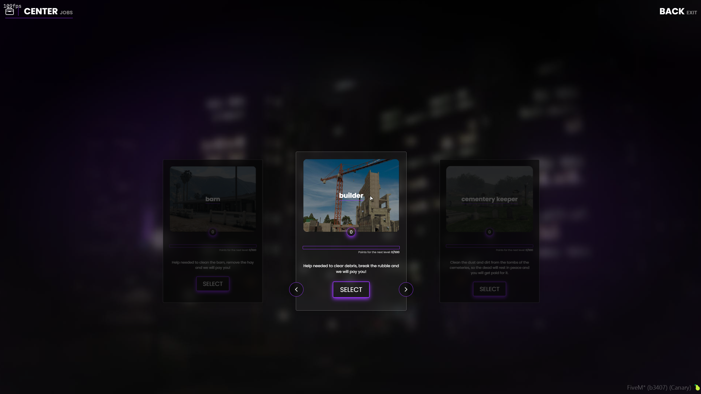

# Civilian Jobs

Civilian jobs allow you to make legal money while completing various jobs. These jobs differ from Whitelisted Jobs (jobs that are player owned). Civilian jobs are great for those who like to grind to make money doing jobs that involve less roleplay.&#x20;

<figure><figcaption>
City Hall Civ Jobs
</figcaption></figure>


Jobs in city do NOT provide passive pay. To make money you have to work to earn it, either legally or illegally.&#x20;


### City Hall

The first stop for jobs is city hall. Here you can find a plethora of interactive jobs that can be done with up to four friends. These jobs are immersive and fun to do; you are not locked to any single job. These jobs range from cleaning up the cemetery, to repairs in Sandy, you should give all of them a try at least once.&#x20;

### Odd Jobs

You can find several Odd Jobs around the map, these jobs are similar to City Hall jobs in that they are legal money but are all single player only for those lonesome grinders.&#x20;

* Trucking Logistics - Start from the bottom and work your way up to building a trucking empire.&#x20;
* Cargo Deliver - Want to do trucking deliveries without all the hassle? Cargo deliveries might be for you.&#x20;
* Wine Making - Head to the Vineyard and pick grapes to convert to wine and sell it.&#x20;
* City Worker - Do various task around the city to make cash.&#x20;
* Farming - Head up north and do some fruit and vegetable picking, you can sell it to the local vendor or sell it to a whitelisted business as ingredients.&#x20;
* Fuel Dispatcher - Head to the oil fields to start working with the fuel delivery job.
* Pizza Delivery - Head to the Pizza This location on the map and deliver Pizza just like it's 1999 all over again.&#x20;

