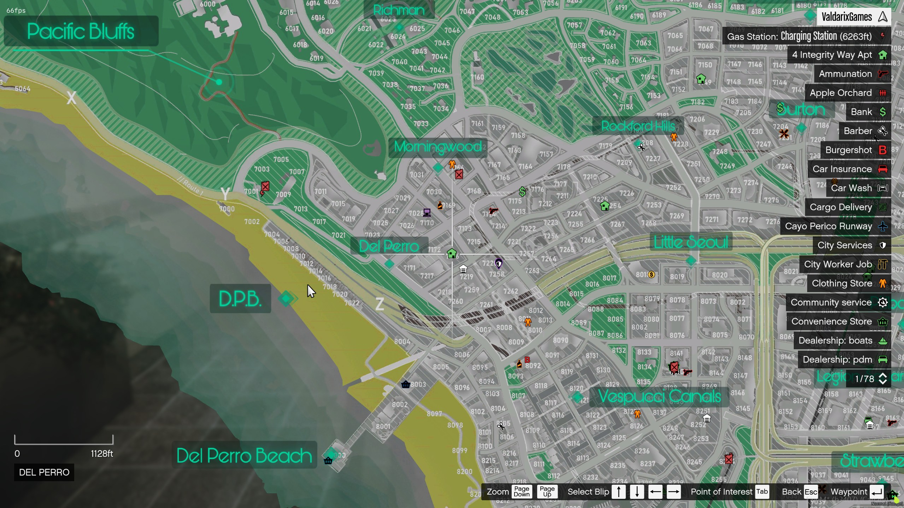
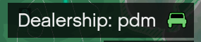
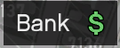
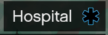
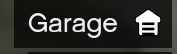
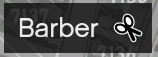
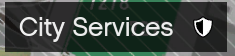
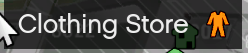
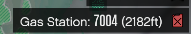

# Important Map Locations

<figure><figcaption>
The Map
</figcaption></figure>

The map in city will be your best friend for quite a while as you learn where things are located. However it can be a bit overwhelming at first. Icon (Blip) overload is a real challenged when there are a lot of things in city to locate. Below are some important locations to know.

|                                                                     |                                                                                                                                                                                       |
| ------------------------------------------------------------------- | ------------------------------------------------------------------------------------------------------------------------------------------------------------------------------------- |
|                                    | Location to purchase all vehicles for civilians.                                                                                                                                      |
|        | Make deposits and withdrawls. Cash is an item so don't get caught with a pocket full of cash                                                                                          |
|        | Need medical assistance? Head over to pillbox and check in.                                                                                                                           |
|        | These are scattered around the map and allow you to access your vehicles, you can transfer cars between garages for a fee.                                                            |
| .png>) | This should be one of your first stops to grab some food and water, so you don't starve to death.                                                                                     |
|        | Not happy with your appearance, head over here to adjust some things, more detailed adjustments can be made at the plastic surgeon.                                                   |
|        | Need a license, id, etc? Head to city services to buy one.                                                                                                                            |
|        | Need to change your clothes? Head over to the clothing store to setup some outfits.                                                                                                   |
|        | Located in the same spot as City Services you can head hear to grab city hall jobs. There are also some other non-city hall jobs scattered around the map. Find what suits you best.  |
|        | Need gas or to charge your EV? Head to a gas station, usually located at or near a convivence stores.                                                                                 |

There are lots of other locations on the map for you to explore. Get your bearings and find out what else is out there.&#x20;

### Secret Locations

There are lots of important unmarked locations on the map. Can you find them? They could prove very valuable if you can.&#x20;
