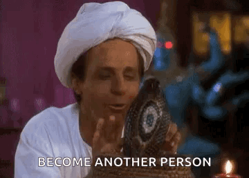

# Roleplay Overview

## Overview

Roleplay can be a very fun and addictive way to enhance your gaming. In fact, GTA RP is one of the most watched categories on Twitch. But it can also be difficult to grasp at first for some new to the genre. When playing in a city it is important to try to stay in character at all times, while also remembering that you are playing a character, like an actor in a movie, you are the actor and not the character.&#x20;

***


Point Hope RP is a semi-serious RP server that sits on the line of serious, that means it is not:&#x20;

* a single player game, if you are engage in RP, then RP, your single player experience is secondary to RP and it is not about what you have.&#x20;
* a dating simulator, this isn't a virtual world to swipe right on, don't fall in love with pixels and a voice, it never ends well.
* a virtual chat room to stand around and talk OOC. Your interactions should be your characters and not yours.&#x20;


### **Understanding the Boundary Between Player and Character in Roleplay**

When participating in a roleplay server, it's essential to recognize the fundamental distinction between you—the person in the chair—and the character you're portraying. Your avatar exists in a fantasy world specifically designed for creative expression and entertainment. \
\
The character interactions that unfold during roleplay are not personal reflections on the players themselves. When another player's character criticizes, challenges, or even antagonizes your character, remember that these actions are directed at your fictional persona, not at you as an individual. Similarly, the choices your character makes should stem from their unique personality and circumstances, not simply mirror what you would do in real life. \
\
Effective roleplay involves creating and embodying a character with distinct motivations, flaws, and perspectives that may differ significantly from your own. This separation not only enhances the immersive quality of the experience but also helps maintain a healthy emotional distance between in-game events and real-life feelings. \
\
The most rewarding roleplay experiences often come from embracing this distinction—allowing your character to develop organically within the fictional world while you, the player, enjoy the creative journey without taking in-game interactions personally. Remember that everyone on the server is there to create interesting stories and have fun, even when those stories involve conflict or tension between characters.\
\
\
**When in doubt. Don't just play yourself in a virtual world but try to.....**

<figure><figcaption>
Become another person
</figcaption></figure>

