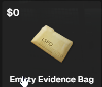
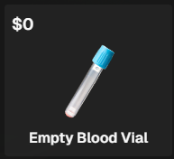
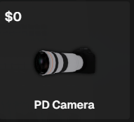
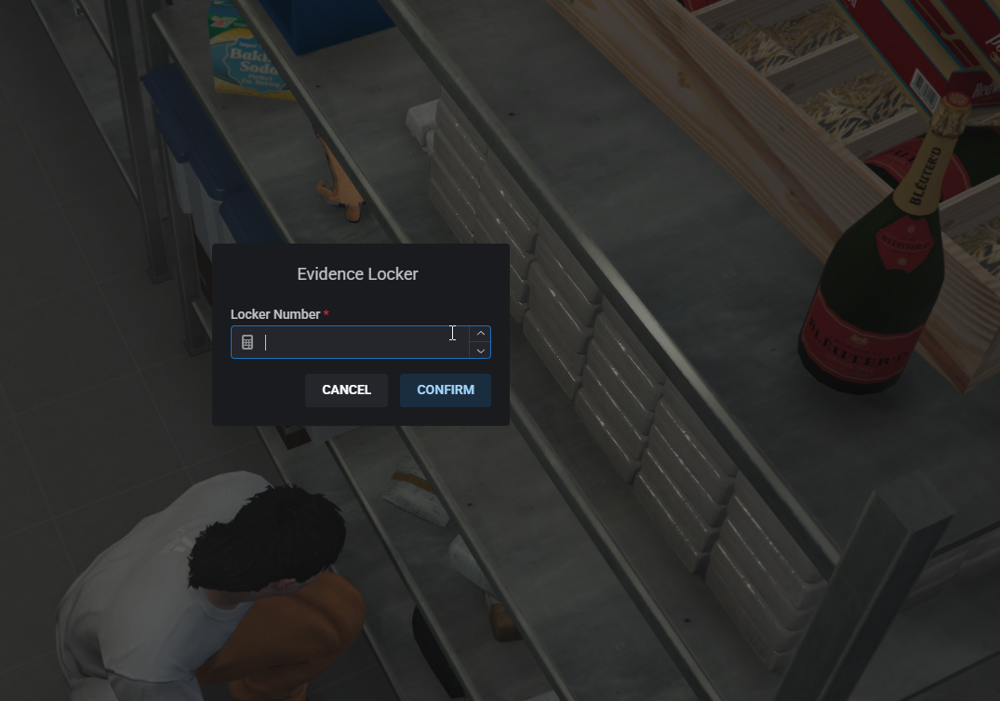

# Collecting Evidence

You need evidence to build a case that will put someone away for a long time.

.png>)


The items needed to collect evidence can be purchased in the Armory.&#x20;


## Searching for evidence

1. You must have the necessary items in your inventory.
2. You can use your flashlight or the PD Camera to look for evidence to collect. Please note that currently the PD is for searching and flavor only, it does not take actual photos.&#x20;
3. Once you have located the evidence you can walk up to it and flex E to collect the evidence.&#x20;
4. The evidence collected will give you lots of information in the tooltips so make sure to utilize that in your reports.  

## Storing Evidence

<figure><figcaption>
MRPD Location Show
</figcaption></figure>

Once you have your evidence collected and are ready to store it you can place it in the Evidence lockers found at each Police station. You should make sure to include this Evidence Locker number in your MDT reports so you can easily retrieve the evidence at a later date. You can find the location of each stations evidence locker under [Departments](../departments/)
