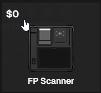

# Fingerprint Scanning

You can scan a players fingerprints in two ways.  

1. At the police stations finger print location

or&#x20;

2. Using the Fingerprint scanner located in the armory you can fingerprint a player while outside the station. &#x20;

