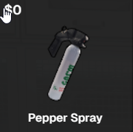
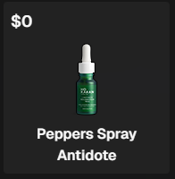
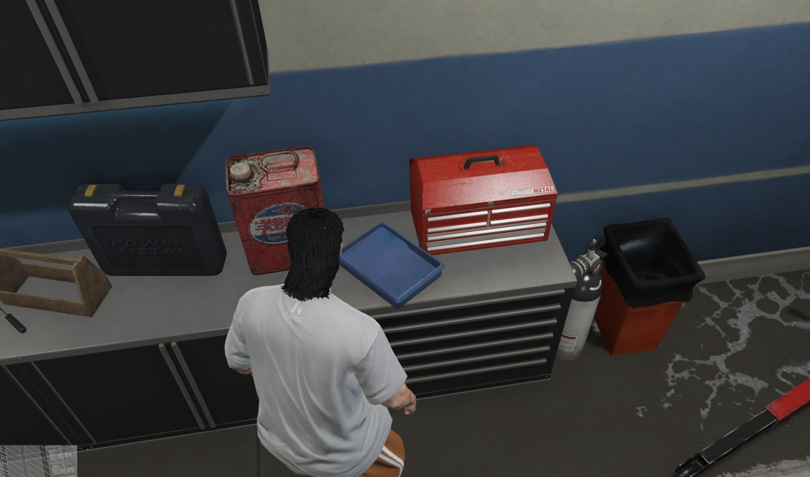

# Pepper Spray




Pepper spray and antidotes can be stolen and used by players.&#x20;


Pepper spray and the antidote are both equipped and used like weapons and can be purchased in the armory at any police station.&#x20;

### Key binds for PD

|     |                                         |
| --- | --------------------------------------- |
| `G` | Refill Pepper Spray at refill station.  |

<figure><figcaption>
Recharge Location
</figcaption></figure>


Pepper spray can be recharged at this location in MRPD, so you don't have to get another canister from the armory.&#x20;


### Key binds for player when they have been sprayed (can be modified)

| Function | Effect        |
| -------- | ------------- |
| `G`      | Spit          |
| `H`      | Rub your eyes |


Note: Certain Masks worn by players will negate the effects of the pepper spray.&#x20;

