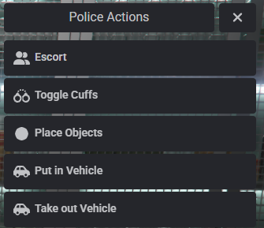

# Police Job Basics

## Script

Our city is one of a few lucky cities to have a 100% custom police script written by a very trusted developer (Randolio) in the FiveM space. Becasue of that some of our features are a little different from other police scripts you might have used in the past.&#x20;

## Police Menu(s)

Using `F6` you can open your police actions menu. The police actions menu gives you a set of basic commands that allow you to do your job.&#x20;

<figure><figcaption></figcaption></figure>

> * Escort - Allows you to escort a player
> * Toggle Cuffs - Place and remove cuffs from players
> * Place Objects - Place props in the world to add flavor to your job, third eye the props the remove them&#x20;
> * Put in vehicle - Put the player in a vehicle
> * Take out Vehicle - Take the player out of the vehicle.&#x20;
>
>


The radial menu is a neglected work in progress and will be updated in time,&#x20;


### Third Eye Menu(s)

If you third eye a player you will get another menu, this menu includes:

> * GSR Test - Test the subject for gunshot residue.&#x20;
> * Toggle Cuffs - Place and remove cuffs from players
> * Frisk - Pat the player down without actually searching them, this will let you know if you feel a weapon or if they are carrying a container bag (duffle, backpack, etc). This can give you probable cause to do a full search.&#x20;
> * Search - open the player inventory to do a thorough search of their inventory. You need probable cause or a warrant to search the player.&#x20;

Third eyeing a vehicle will give you the following menu:

> * Search Vehicle - Search the vehicle for finger prints
> * Police Unlock - Unlock the vehicle without the keys.&#x20;
> * Put in vehicle - Put the player in a vehicle
> * Take out Vehicle - Take the player out of the vehicle.&#x20;

## Slash Commands and Key binds


The below actions and keybninds are specific to the police job itself there are other key binds and helpful commands located [here](../misc-keybinds-and-commands.md)


<table><thead><tr><th width="192">Action</th><th width="113">Type</th><th>Result</th></tr></thead><tbody><tr><td><code>localiv</code></td><td>slash</td><td>Used impound cars that are NOT player owned. See <a href="impound.md">Impound</a> for player owned cars.</td></tr><tr><td><code>panic</code></td><td>slash</td><td>call for backup</td></tr><tr><td><code>setcallsign</code></td><td>slash</td><td>set callsign</td></tr><tr><td><code>cuff</code></td><td>slash</td><td>alternate way to soft cuff a player</td></tr><tr><td><code>hcuff</code></td><td>slash</td><td>alternate way to hard cuff a player, requires handcuffs</td></tr><tr><td><code>escort</code></td><td>slash</td><td>alternate way to escort a player</td></tr><tr><td><code>N</code></td><td>bind</td><td>Freeze Air 1</td></tr><tr><td><code>E</code></td><td>bind</td><td>Open Helicam</td></tr><tr><td><code>X</code></td><td>bind</td><td>Repel from helicopter</td></tr><tr><td><code>backspace</code></td><td>bind</td><td>Close Evidence Camera</td></tr><tr><td><code>cams</code></td><td>slash</td><td>View CCTV Cameras</td></tr></tbody></table>
